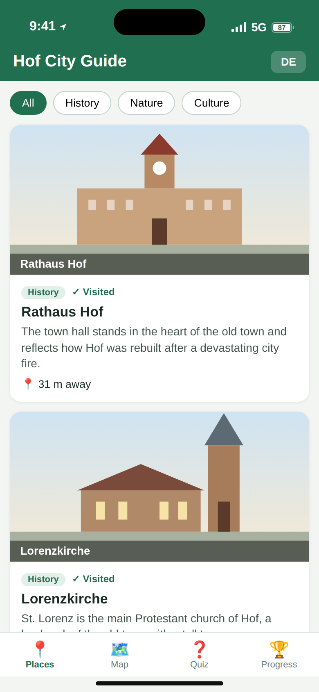
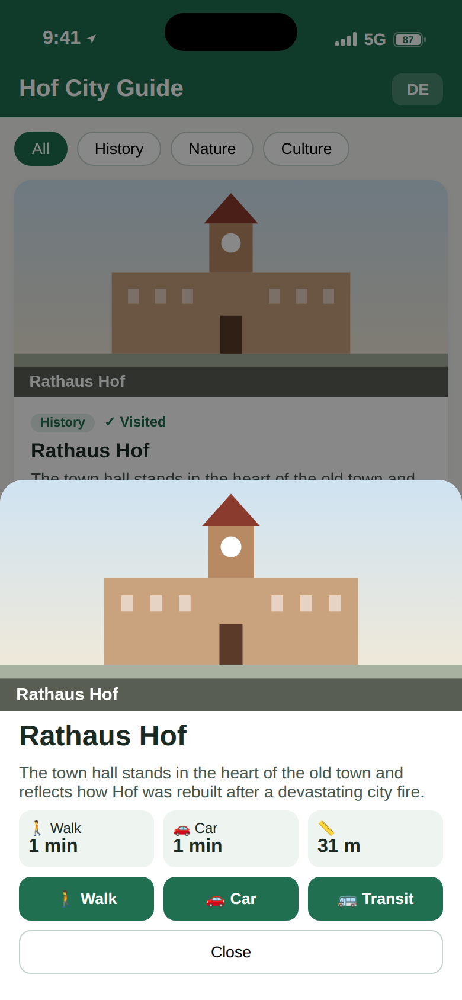
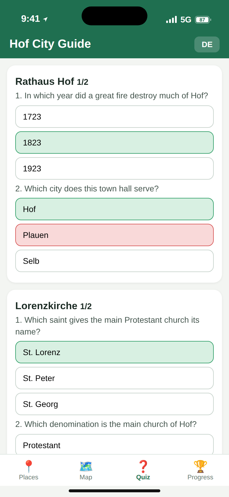
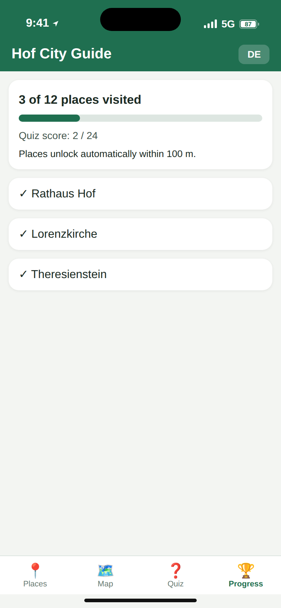
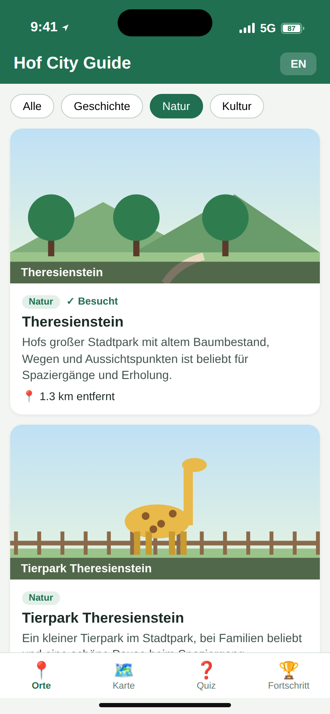

# Hof City Guide


A hybrid Android and iOS city guide for **Hof (Saale), Bavaria**, built with **Vue 3, TypeScript, Pinia, vue-i18n and Capacitor**.

## Features
- 12 tourist places in Hof, each with a 3-image gallery, description and category filters (History, Nature, Culture)
- Google Maps: interactive map tab with markers (Maps JavaScript API), real travel durations for walking, driving and public transport (Directions API) and one-tap navigation in Google Maps
- GPS check-in (Capacitor Geolocation): a place is marked as visited automatically within **100 m**
- Gamified quiz modules: two questions per place, unlocked when you visit it, with a score per module and overall progress
- English / German localization (switch with the EN/DE button)

## Screenshots
| Places | Place detail | Quiz |
|---|---|---|
|  |  |  |

| Progress | German UI with Nature filter |
|---|---|
|  |  |

## Getting started
```bash
npm install
npm run dev            # open http://localhost:5173 (add ?demo for sample data)
npm run build
npm run lint            # ESLint (Vue + TypeScript)
npm run format         # Prettier (use format:check to only verify)
npm run typecheck
```


### Run on Android / iOS
The native projects are included (`android/`, `ios/`) and the location permissions are already set.
```bash
npm install
npm run android   # builds the web app, syncs it and opens Android Studio
npm run ios       # macOS only: opens Xcode (run `pod install` in ios/App once if Xcode asks for it)
```
Requirements: Android Studio with JDK 17; Xcode 15+ and CocoaPods on a Mac for iOS. After changing web code run the same command again (or `npm run cap:sync`).


## Project structure
```
android/, ios/            Capacitor native projects (permissions set)
src/App.vue               App shell: header, tabs, category filters
src/components/           PlaceCard, PlaceSheet (gallery, routes), QuizModule, ProgressView, MapView
src/composables/          useLang (i18n helper)
src/data/places.ts        12 places with EN/DE descriptions and the first quiz question
src/data/quiz.ts          Quiz modules (2 questions per place)
src/stores/app.ts         Pinia store: GPS, visited places, quiz answers
src/utils/                geo (distance), maps (Google Maps API), format, images
src/i18n.ts, styles.css   EN/DE texts, global styles
```


## License
MIT, see [LICENSE](LICENSE).
